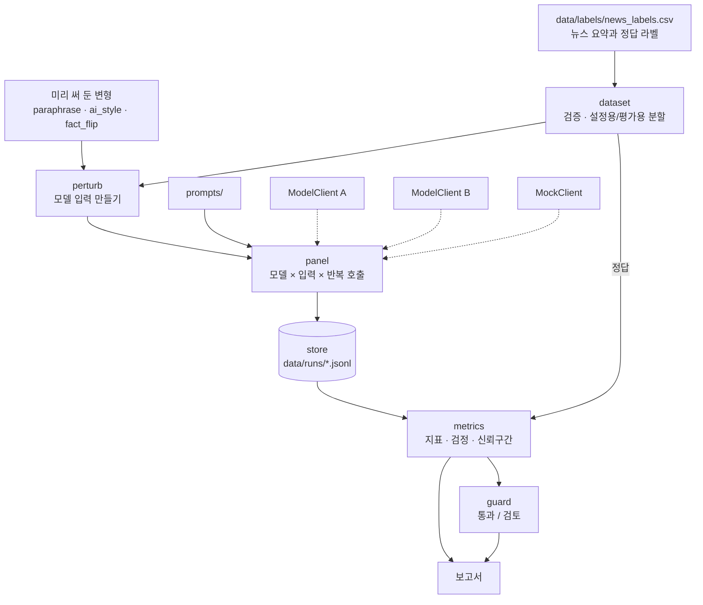

# 아키텍처

2026-11-15 · 코드가 어떻게 나뉘어 있고 데이터가 어디로 흐르는지.

## 1. 한눈에



실선은 데이터 흐름, 점선은 끼워 넣는 부품이다. `pipeline`이 이 순서대로 각 층을 부른다.

## 2. 층별 책임

| 층 | 파일 | 하는 일 | 하지 않는 일 | LLM |
|---|---|---|---|---|
| 데이터 | `dataset.py` | 라벨 파일 검증, 60/40 분할 | 라벨 수정 | 없음 |
| 변형 | `perturb.py` | 뉴스 한 건을 모델 입력 여러 개로 | 변형 글을 직접 쓰기 | 없음 |
| 패널 | `panel.py` | 호출, 형식 검사, 재요청, 기록 | 응답 해석·채점 | 호출만 |
| 저장 | `store.py` | 기록 쌓기, (모델, 뉴스, 반복) 배열로 변환 | 계산 | 없음 |
| 측정 | `metrics.py` | 지표 ①~④, 순열검정, 부트스트랩 | 파일·네트워크 접근 | 없음 |
| 가드 | `guard.py`, `learned_guard.py` | 통과/검토 판정, 틀릴 확률 추정, 가드 성능 평가 | 답을 고치기 | 없음 |
| 흐름 | `pipeline.py` | 위 층을 순서대로 실행, 보고서 조립 | 자체 계산 | 없음 |

LLM이 관여하는 곳은 패널층 하나뿐이다. 그 뒤의 모든 숫자는 저장된 기록에서 코드가 계산한다.

## 3. 층 사이에 오가는 것

| 이름 | 정의된 곳 | 내용 | 만드는 층 → 쓰는 층 |
|---|---|---|---|
| `NewsItem` | `dataset.py` | 뉴스 요약, 정답 라벨, 출처 확인 여부, 분할 | 데이터 → 변형, 측정, 가드 |
| `PanelInput` | `perturb.py` | 뉴스 ID, 변형 이름, 모델에 넣을 글 | 변형 → 패널 |
| `RunRecord` | `schema.py` | 호출 한 번의 결과와 모델 버전·시각 | 패널 → 저장 |
| 배열 (모델, 뉴스, 반복) | `store.to_array` | 순서형 정수, 실패는 NaN | 저장 → 측정 |
| 배열 (모델, 뉴스) | `metrics.model_answers` | 모델별 대표 답 | 측정 → 가드 |

`PanelInput`에는 정답이 없다. 모델 쪽으로 정답이 새는 길을 자료 구조에서 막았다.

## 4. 설계 결정

**모델은 부품으로 끼운다.** 패널층은 `ModelClient` 모양(`name`, `family`, `version`, `complete`)만 안다. 새 모델을 추가할 때 다른 층은 바뀌지 않는다. `MockClient`도 같은 모양이라 API 없이 전체가 돈다.

**저장한 것을 다시 읽어 계산한다.** `pipeline.run`은 기록을 파일에 쓴 뒤 그 파일을 읽어 지표를 낸다. 호출 없이 `analyze`만 다시 돌려도 같은 숫자가 나온다.

**실패는 지우지 않는다.** 형식 위반은 2회 재요청 후 `output=None`으로 남긴다. 반복 중 일부만 실패하면 나머지로 대표 답을 내고, 전부 실패하면 오답으로 센다.

**가드 임계값은 평가용 뉴스를 보지 않고 정한다.** 가드 성능은 `split == "eval"`인 40건에서만 채점한다.

**측정층은 순수 함수다.** 입력은 배열, 출력은 숫자. 파일도 네트워크도 건드리지 않아서 손계산과 대조하는 테스트를 붙일 수 있다.

## 5. 폴더

```
echoguard/
├── config/experiment.yaml      실험 설정 (시드, 반복 수, 변형, 가드 임계값)
├── prompts/                    모델에 주는 지시문
├── data/
│   ├── labels/                 뉴스 요약과 정답 (공개)
│   └── runs/                   모델 응답 기록 (비공개, .gitignore)
├── src/echoguard/
│   ├── dataset.py  perturb.py  panel.py  store.py
│   ├── metrics.py  guard.py    pipeline.py
│   ├── clients.py  check.py    실제 모델 호출, 시험 호출
│   ├── schema.py               모델 출력·기록 형식
│   └── mock.py                 모의 뉴스와 모의 모델
├── tests/
└── docs/
```

## 6. 지금 되는 것과 안 되는 것

```bash
pip install -r requirements.txt
PYTHONPATH=src python -m echoguard.pipeline --mock
```

| | 상태 |
|---|---|
| 모의 모델로 데이터 → 가드까지 전체 실행 | 됨 |
| 지표, 순열검정, 신뢰구간, 규칙 가드 G1~G4b, 학습 가드 G5a·G5b | 됨, 테스트 있음 |
| 필터 (`filter.py`): 정답을 모르는 문서 한 건의 패널 답을 그 자리에서 통과/검토로 판정하고 이유를 돌려줌. 실험과 같은 가드 함수를 씀 | 됨, 테스트 있음. 실제 모델로는 아직 안 돌림 |
| 입력 점검 G0 (`disclosure.quality`), 판정 기록과 사람 검토 기록 (`audit.py`) | 됨, 테스트 있음 |
| 출처 확인 (`source.py`, 전자공시 접수 목록 조회), 모델 변경 감지 (`drift.py`), 숨긴 지시문 변형 (`injection`), 말 바꾼 요약 (`render_alt`) | 됨, 테스트 있음. 전자공시와 실제 모델로는 아직 안 돌림 |
| 공시 숫자에서 요약·정답·뒤집은 글 만들기 (`disclosure.py`), 근거 대조 가드 G6 | 됨, 테스트 있음. 실제 모델로는 아직 안 돌림 |
| 유효 모델 수와 분산 하한, 같은 오답 비율의 무작위 기준선, 균질화 비율, H2·H7 격차의 신뢰구간 | 됨, 테스트 있음 (2026-11-16 추가) |
| 조작 입력(source_swap, fact_flip, fake_corroboration)을 포함한 가드 평가 | 됨 |
| G4의 실제 출처 조회 | 없음. 지금은 라벨의 독립 출처 수를 그대로 쓰는 상한선 |
| 실제 모델 클라이언트 (Anthropic, OpenAI, Google) | 됨. 2026-11-15 시험 호출에서 여섯 모델 모두 정상 응답 ([pilot_log.md](pilot_log.md)) |
| 뉴스 데이터 | 시범용 10건만 있음(잠정실적 공시, 공개 전). 100건이 목표. 공시는 숫자에서 정답을 계산하는 규칙 라벨(`labeling.py`) |
| 호출마다 저장, 중단 후 이어서 실행 | 됨, 테스트 있음 |
| 실제 실행 (`pipeline --run`) | 돌아감. 2026-11-16 시범 실행에서 중단 후 이어서 실행까지 확인 ([pilot_log.md](pilot_log.md)) |
| 공시 후보 추출 (`scripts/sample_candidates.py`) | 됨. 2026-11-15 실행에서 잠정실적 공시 597건 중 140건 추출 |
| paraphrase·ai_style 변형 생성기 | 없음. 지금은 미리 써 둔 글을 받기만 함 |
| 개인 트랙 | 출력 형식만 정의. 채점은 범주형이라 별도 지표가 필요 |
| 가드 임계값을 설정용 60건에서 고르는 단계 | 없음. 지금은 설정 파일의 임시값 사용. 등각 방식으로 정할 계획 ([experiment_spec.md](experiment_spec.md) 8장) |
| 금융 영향(집중도 시나리오별 ES, 독립인 세계와의 비교) | 됨, 테스트 있음 (2026-11-16). 손익은 단위 크기이고 실제 수익률은 쓰지 않는다 |

모의 실행의 숫자는 의미가 없다. 모의 모델에 "함께 틀리는" 성질을 심어 두었고, 측정층이 그것을 찾아내는지 확인하는 용도다.
